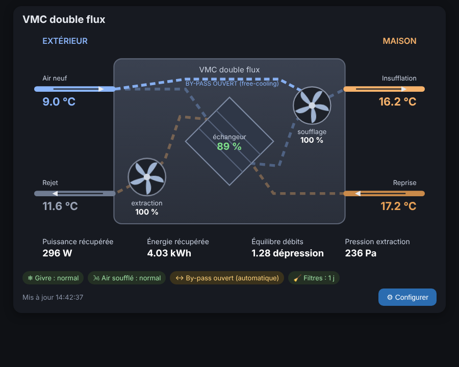
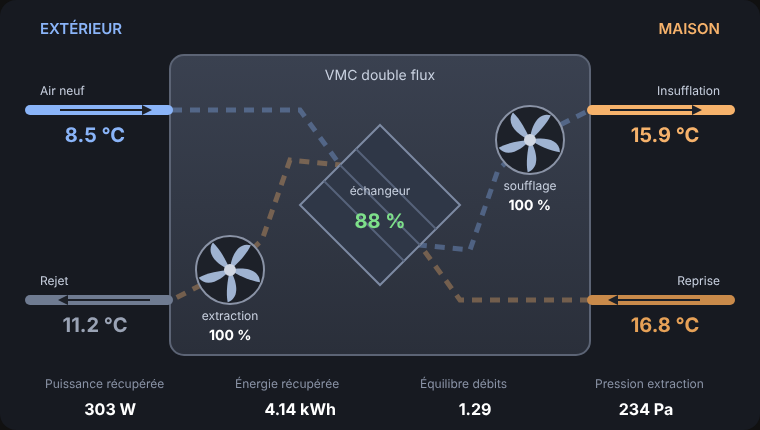

# VMC double flux × ESPHome × Home Assistant

Supervision et pilotage d'une **VMC double flux** (testé sur **Atlantic Duocosy HR HY**, moteurs ebm-papst R3G140 EC 0-10 V) avec **ESPHome** et **Home Assistant**, en remplacement de la régulation d'origine.

## Ce que ça fait

- **4 sondes DS18B20** (air neuf, insufflation, reprise, rejet), avec **affectation des sondes modifiable depuis l'interface**, sans recompiler.
- **Rendements** côté soufflage et côté extraction, rendement moyen sur 1 h, **puissance et énergie récupérées**.
- **Rapport des débits extraction/soufflage**, calculé par bilan thermique de l'échangeur : équilibre ou dépression de la maison.
- **Pression du réseau d'extraction**, mesurée par le capteur Huba d'origine (0,5-4,5 V = 0-300 Pa).
- **Commande des 2 moteurs EC en 0-10 V**, de 10 à 100 %.
- **Alertes** : risque de givre de l'échangeur, air soufflé froid, by-pass ouvert, filtres à changer (compteur de jours avec remise à zéro).
- **By-pass / free-cooling** automatique (version KinCony) : principe 24 °C / 12 °C, avec seuils réglables et modes forcés.
- **Relais de coupure** des moteurs, câblés sur le contact NF pour la sécurité (version KinCony).
- **Page web autonome** dans l'ESP : un schéma animé de la VMC, et une page de configuration protégée par code.
- **Cartes Home Assistant** : un schéma « picture-elements » et des tuiles Mushroom.

## Deux versions matérielles

| | `esphome/vmc-kincony-a6.yaml` ✅ recommandé | `esphome/vmc-esp32-devkit.yaml` |
|---|---|---|
| Carte | KinCony KC868-A6 (ESP32, 12 V, environ 30 €) | ESP32 DevKit + platine à trous |
| Sorties 0-10 V | 2 sorties actives (ampli LM258) | DAC + transistor 2N2222 contre une résistance de tirage |
| Capteur Huba | Alimenté en 12 V par la carte, sur l'entrée A1 | Alimenté par la carte d'origine, via un pont diviseur |
| Relais | 6 (coupure des moteurs, by-pass…) | aucun |
| Carte d'origine | **supprimée** | conservée (uniquement pour le 12 V du Huba) |

## Installation (résumé)

1. **ESPHome Builder** → créer un appareil (la carte « KinCony KC868-A6 » est proposée), puis coller la config. Remplir les secrets en partant de `esphome/secrets.example.yaml`.
2. Copier `esphome/vmc_synoptique.js` **dans le même dossier** que le `.yaml` (`/config/esphome/`).
3. Premier flash en USB, les suivants en OTA.
4. Home Assistant :
   - copier `homeassistant/www/*.svg` dans `/config/www/` ;
   - coller `homeassistant/dashboards/carte-schema.yaml` et/ou `carte-tuiles.yaml` dans une carte en mode manuel ;
   - l'automatisation `homeassistant/automations/vmc-soufflage-nuit.yaml` est optionnelle (70 % de 22 h à 6 h).
5. Ouvrir `http://<IP-de-l-ESP>` : schéma en direct, bouton **⚙ Configurer** (code `admin` par défaut, modifiable en haut du `.js`).

Détails : [`docs/cablage-kincony-a6.md`](docs/cablage-kincony-a6.md), [`docs/cablage-esp32-devkit.md`](docs/cablage-esp32-devkit.md), [`docs/etalonnage-et-mesures.md`](docs/etalonnage-et-mesures.md).

## ⚠️ Avertissements

- **Le 230 V est dangereux.** Coupez et consignez avant d'intervenir. Les relais commutent la phase. Séparez bien le 230 V de la très basse tension dans le boîtier.
- **Ne reliez jamais la sortie +10 V (fil rouge) d'un moteur EC à un transistor ou à la masse.** Un court-circuit répété (par exemple avec du PWM) **a détruit l'alimentation interne** de l'interface 0-10 V d'un moteur pendant le développement. Voir [`docs/retour-d-experience.md`](docs/retour-d-experience.md).
- Remplacer la régulation d'origine **annule la garantie du fabricant** et sort l'appareil de son avis technique. À vos risques.
- **Débits** : pour l'énergie, gardez la maison en légère dépression (rapport des débits entre 1,0 et 1,1). Avec un **appareil à combustion qui prend son air dans la pièce** (poêle, insert…), évitez toute forte dépression et installez un détecteur de CO.
- Le code `admin` de la page web ne fait que **masquer** la configuration. Pour une vraie protection, activez `auth:` dans `web_server`.

## Licence

MIT. Voir [`LICENSE`](LICENSE).
